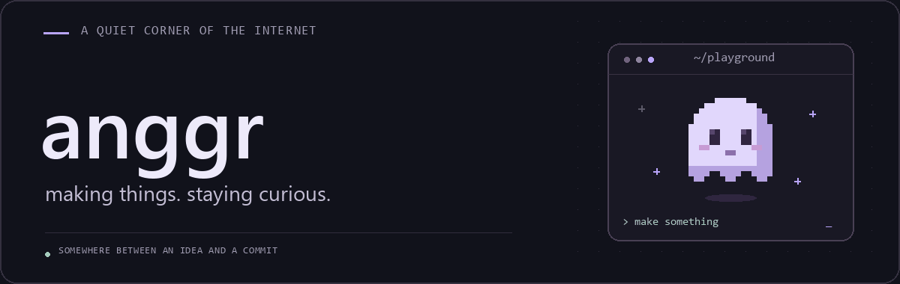



  
   
   
  <samp>. build things.</samp>
   
   
  <a href="https://github.com/anggr?tab=repositories">explore the repos ↗</a>
  &nbsp;&nbsp;·&nbsp;&nbsp;
  <a href="https://anggoroo.com">visit my site ↗</a>

 

### a little behind the alias

Hey, I'm **anggr**. I build things for the web and learn by making them.
Some turn into useful tools. Some stay little experiments. Both belong here.

### the workbench

Tools I work with, tinker with, and keep coming back to:

  <code>TypeScript</code> &nbsp; <code>Stable Diffusion</code> &nbsp; <code>ComfyUI</code>

  <code>Node.js</code> &nbsp; <code>Prisma</code> &nbsp; <code>PostgreSQL</code> &nbsp; <code>Git</code>

 

---

  still figuring things out. still making things anyway.
   
  thanks for wandering in ✦

